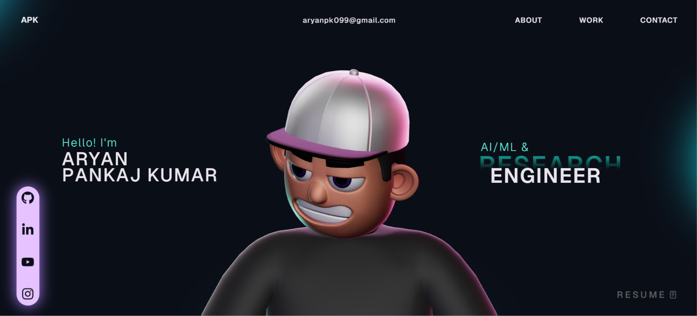

# Aryan Pankaj Kumar — 3D Developer Portfolio

Interactive 3D developer portfolio built with React, TypeScript, Three.js, React Three Fiber, Rapier Physics, and GSAP. Showcases my profile as a **Full-Stack Developer, AI/ML Engineer, and Medical AI & Hybrid Quantum ML Researcher** at Shoolini University.

**Live App:** [https://portfolioapk.netlify.app/](https://portfolioapk.netlify.app/)



## Table of Contents

- [Features](#features)
- [Tech Stack](#tech-stack)
- [Project Structure](#project-structure)
- [Getting Started](#getting-started)
- [Available Scripts](#available-scripts)
- [GSAP License Note](#gsap-license-note)
- [Customization Guide](#customization-guide)
- [Troubleshooting](#troubleshooting)
- [Deployment](#deployment)
- [License](#license)

## Features

- Responsive one-page portfolio layout with reusable section components.
- 3D character scene rendering powered by React Three Fiber and Three.js.
- GSAP-powered animations and transitions for interactive storytelling.
- Custom cursor, hover interactions, and scroll-driven visual effects.
- Organized component architecture with dedicated utilities and style modules.

## Tech Stack

### Core

- React 18
- TypeScript
- Vite

### Animation and 3D

- GSAP (`ScrollTrigger`, `ScrollSmoother`, `SplitText`)
- Motion (`motion/react`)
- Three.js
- `@react-three/fiber`
- `@react-three/drei`
- `@react-three/postprocessing`
- `@react-three/rapier`

### Supporting Libraries

- `react-icons`
- `react-fast-marquee`
- `clsx` & `tailwind-merge`

## Project Structure

```text
.
├── public/
│   ├── draco/                 # Local Draco WASM/JS decoder for compressed 3D assets
│   ├── images/                # Project cover previews
│   ├── logos/                 # Tech stack sphere logos
│   ├── models/                # Encrypted character GLB & HDR environment map
│   ├── Aryan_Pankaj_Kumar.pdf # Resume PDF
│   └── favicon.svg
├── src/
│   ├── components/
│   │   ├── Character/         # 3D scene + character loader/rig/lighting utilities
│   │   ├── styles/            # Section/component CSS files
│   │   ├── ui/                # Reusable UI effects (ShimmerText)
│   │   ├── utils/             # GSAP scroll/split-text helpers
│   │   ├── About.tsx
│   │   ├── Career.tsx
│   │   ├── Contact.tsx
│   │   ├── Landing.tsx
│   │   ├── MainContainer.tsx  # Main page composition
│   │   ├── Navbar.tsx
│   │   ├── TechStack.tsx
│   │   ├── WhatIDo.tsx
│   │   └── Work.tsx
│   ├── context/               # Global providers (loading state)
│   ├── data/                  # Static skeleton/bone definitions
│   ├── lib/                   # Utility helpers (`cn`)
│   ├── types/                 # TypeScript ambient module declarations
│   ├── App.tsx
│   └── main.tsx
├── netlify.toml               # Netlify build command & SPA redirect config
├── package.json
└── vite.config.ts
```

## Getting Started

### Prerequisites

- Node.js 18+ (recommended)
- npm 9+ (or compatible)

### Installation

1. Clone the repository:

   ```bash
   git clone https://github.com/dat1aryan/portfolio.apk.git
   cd portfolio.apk
   ```

2. Install dependencies:

   ```bash
   npm install
   ```

3. Start the local development server:

   ```bash
   npm start
   ```

   *(Or `npm run dev`)*

4. Open the URL shown in the terminal (typically `http://localhost:5173`).

## Available Scripts

- `npm start` / `npm run dev`  
  Starts Vite dev server and exposes host for local network testing.

- `npm run build`  
  Type-checks and builds a production-ready bundle.

- `npm run preview`  
  Serves the production build locally for verification.

- `npm run lint`  
  Runs ESLint checks across the project.

## GSAP License Note

This project uses the standard `gsap` package, including bonus plugins now available in the core package.

- Install dependencies with `npm install`.
- If migrating from older setups, remove `gsap-trial` from your project.

Read official installation guidance here: [GSAP Installation Docs](https://gsap.com/docs/v3/Installation/)

## Customization Guide

You can adapt this portfolio to your own profile by updating the following areas:

- **Content sections**: Edit files in `src/components/` such as `About.tsx`, `Career.tsx`, `WhatIDo.tsx`, and `Work.tsx`.
- **Data source**: Update static values in files under `src/data/`.
- **Styling**: Modify component styles in `src/components/styles/` and global styles in `src/index.css` / `src/App.css`.
- **3D scene behavior**: Adjust scene logic in `src/components/Character/` and related utilities.
- **Animations**: Tweak GSAP utilities under `src/components/utils/`.

## Troubleshooting

- **Blank screen in development**  
  Check browser console for module import errors and verify all dependencies are installed.

- **3D performance issues on low-end devices**  
  Reduce scene complexity and post-processing effects in the character/scene utilities.

- **GSAP plugin errors**  
  Ensure you have the correct plugin package and license configuration for your target environment.

- **TypeScript build failures**  
  Run `npm run build` and address reported type errors before deploying.

## Deployment

1. Create a production build:

   ```bash
   npm run build
   ```

2. Validate locally:

   ```bash
   npm run preview
   ```

3. Deploy the generated `dist/` folder to Netlify (preconfigured via `netlify.toml`), Vercel, or Cloudflare Pages.

## License

This project is open source and available under the [MIT License](LICENSE).
